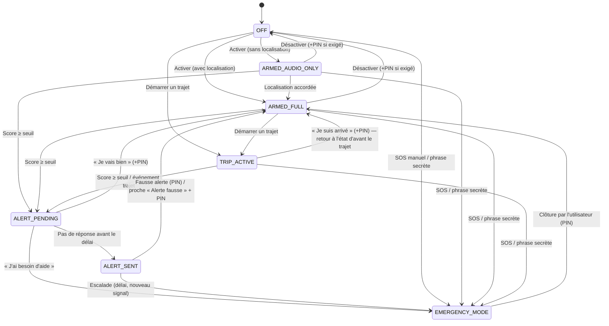

# Machine à états et escalade

Ce document est la **source de vérité** du comportement de l'application. Il est implémenté par `alert-engine` ; `ui-mobile` ne fait qu'afficher l'état et envoyer des intentions.

## États

| État | Micro | Position | Capteurs | Partage externe | Description |
|---|---|---|---|---|---|
| `OFF` | ✗ | ✗ | ✗ | ✗ | Aucune écoute, aucune géolocalisation. Le SOS manuel reste disponible. |
| `ARMED_AUDIO_ONLY` | ✓ | ✗ | mouvement léger | ✗ | IA audio locale active, sans GPS. |
| `ARMED_FULL` | ✓ | ✓ (basse fréquence) | ✓ | ✗ | IA audio, position et capteurs. |
| `TRIP_ACTIVE` | ✓ si activé | ✓ | ✓ | ✗ (sauf partage de trajet choisi) | Trajet déclaré avec une destination et une heure d'arrivée prévue. |
| `ALERT_PENDING` | ✓ | ✓ si autorisé | ✓ | ✗ | Signal potentiel, en attente de confirmation (niveau 1). |
| `ALERT_SENT` | ✓ | ✓ | ✓ | ✓ proches | Alerte envoyée aux proches (niveau 2 ou 3). |
| `EMERGENCY_MODE` | ✓ + enregistrement | ✓ haute fréquence | ✓ | ✓ proches (+ direct si réseau) | Alerte maximale (niveau 3 ou 4). |

« Mode discret » n'est **pas un état**. C'est une **option de présentation** qui s'applique à tous les états armés : pas de son, vibration codée, interface neutre ou leurre. L'indicateur système du micro reste toutefois visible, car Android l'impose.

## Diagramme

Après la clôture d'une alerte, on revient à l'état armé **précédent** : `TRIP_ACTIVE` si le trajet n'est pas terminé, sinon `ARMED_FULL` ou `ARMED_AUDIO_ONLY` selon les permissions. Par simplicité, le diagramme montre `ARMED_FULL`.

## Précisions tranchées à l'implémentation (S1)

- « J'ai besoin d'aide » pendant une vérification vaut un SOS : passage direct en `EMERGENCY_MODE`, niveau 3 (et non niveau 2).
- « Je suis arrivé » ramène à l'état d'avant le trajet (`OFF`, `ARMED_AUDIO_ONLY` ou `ARMED_FULL`), pas systématiquement à `ARMED_FULL`.
- Armer utilise la position dès qu'elle est autorisée (`ARMED_FULL`), sinon `ARMED_AUDIO_ONLY`. Sans micro ni position, l'armement est refusé.
- Après une vérification annulée (« Je vais bien »), la même raison est ignorée pendant 2 min (période réfractaire).
- Implémentation : `android/alert-engine` (`AlertEngine.reduce`), testée par une table de transitions et des tests de propriétés.

## Règles de transition

| ID | Règle |
|---|---|
| R-SM-01 | Toute transition est **persistée** (base locale chiffrée) **avant** que ses effets de bord ne s'exécutent. Après un redémarrage du processus, l'état est restauré. |
| R-SM-02 | Toute transition produit un `Event` horodaté (horloge système en UTC + horloge monotone) ajouté au journal anti-effacement. |
| R-SM-03 | Les transitions sont des **fonctions pures** (`état + événement + politique → nouvel état + effets`). Elles sont testables sans Android. |
| R-SM-04 | Quitter `ALERT_PENDING`, `ALERT_SENT` ou `EMERGENCY_MODE` vers un état non-alerte exige le PIN ou la biométrie, si l'utilisateur a activé le PIN. |
| R-SM-05 | Le SOS manuel et la phrase secrète vont **directement** en `EMERGENCY_MODE` depuis n'importe quel état, y compris `OFF`. Pour la phrase secrète, le micro doit être actif, donc l'état doit être armé. |
| R-SM-06 | Désactiver la protection pendant un trajet ou une alerte envoie aux proches une notification « Protection désactivée à HH:MM » si l'option est active (par défaut : activée pendant un trajet). |
| R-SM-07 | Les événements reçus en double (même `eventId`) sont ignorés : l'état est **idempotent**. |
| R-SM-08 | Si le service de premier plan est tué par le système, l'état persistant reste armé. Au redémarrage de l'application, l'utilisateur voit « Protection interrompue à HH:MM » et doit **réarmer manuellement** (⚠ Android interdit de relancer le micro en arrière-plan). |

## Niveaux d'alerte

| Niveau | Nom | Déclenchement | Actions | Partage externe |
|---|---|---|---|---|
| 0 | Information | Score faible, détection isolée | Entrée dans le journal local ; notification locale optionnelle | Aucun |
| 1 | Vérification | Score ≥ seuil de vérification | Vibration discrète, notification silencieuse « Es-tu en sécurité ? ». Délai de 10, 20 ou 30 s (20 s par défaut) | Aucun |
| 2 | Alerte proches | Pas de réponse au niveau 1, **ou** événement grave de trajet non confirmé | Message aux contacts choisis : position, heure, raison, confiance, lien de suivi temporaire, extrait audio court si activé. Début de l'enregistrement de preuves | Proches choisis |
| 3 | Alerte élargie | Pas d'accusé de réception d'un proche après X min, **ou** nouveau signal pendant le niveau 2 | Appel automatique au contact n° 1, SMS à plusieurs contacts, notifications répétées, direct audio/vidéo si autorisé | Proches (tous ceux du plan) |
| 4 | Autorités | Uniquement si l'utilisateur l'a configuré | Transmission structurée si une intégration officielle existe ; sinon un **guide d'appel** (numéro, position, description et preuves prêtes). Jamais d'appel automatique non validé | Secours |

### Règles d'escalade

| ID | Règle |
|---|---|
| R-ESC-01 | Pas de saut de niveau, sauf : SOS manuel → niveau 3 ; phrase secrète → niveau 3 (silencieux) ; « urgence automatique » activée explicitement → niveau 2 sans vérification. |
| R-ESC-02 | Le passage au niveau 4 exige **soit** une action de l'utilisateur pendant l'alerte, **soit** un consentement préalable explicite et séparé (« Si je ne réponds pas, contacter les secours »). L'appel aux numéros d'urgence se fait toujours via le composeur (⚠ Android ne permet pas à une application tierce de les appeler directement). |
| R-ESC-03 | Une alerte peut être réduite à tout moment par l'utilisateur (PIN). Un proche peut marquer « J'ai pris contact » : cela arrête l'escalade vers le niveau 3, mais n'annule pas l'alerte côté utilisateur. |
| R-ESC-04 | Les délais (vérification, escalade 2→3) sont configurables entre des bornes : vérification de 10 à 30 s ; escalade 2→3 de 2 à 15 min (5 min par défaut). |
| R-ESC-05 | Chaque alerte a un `alertId` unique. Les messages envoyés portent cet identifiant pour la déduplication côté proche et côté serveur. |
| R-ESC-06 | Une alerte reste ouverte jusqu'à sa clôture explicite par l'utilisateur, ou jusqu'à expiration (24 h) avec une notification aux proches. |
| R-ESC-07 | **Deux signaux indépendants** sont nécessaires pour passer du niveau 0 au niveau 1 en détection automatique (ex. cri + choc, ou cri + accélération brusque). Exceptions : phrase secrète, mot-clé de détresse avec confiance élevée, SOS. |

## Matrice déclencheur → niveau initial

| Déclencheur | Niveau initial | Vérification |
|---|---|---|
| Bouton SOS (appli, widget, tuile) | 3 | Non ; un compte à rebours d'annulation de 5 s est configurable |
| Phrase secrète reconnue | 3, silencieux | Non |
| Mot-clé de détresse (confiance élevée) | 1 | Oui, délai court (10 s) |
| Cri + 2e signal | 1 | Oui |
| Choc ou vitre brisée + 2e signal | 1 | Oui |
| Silence brutal après une forte activité vocale | 0, puis 1 si combiné | Oui |
| Arrêt prolongé, détour, direction opposée | 1 | Oui |
| Arrivée non confirmée à l'heure prévue + marge | 1 | Oui |
| Perte de contact (côté serveur, trajet actif) | 2, envoyé **par le serveur** | Non (le téléphone ne répond plus) |
| Entrée en zone marquée non sûre | 0 ou 1 (au choix de l'utilisateur) | Oui |
