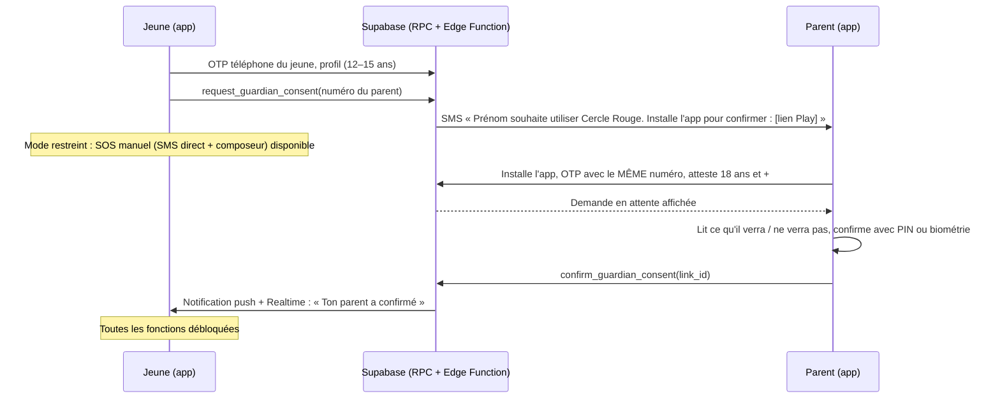

# Module produit 11 — Consentement parental (12–15 ans)

**Objectif** : permettre aux 12–15 ans d'utiliser Cercle Rouge avec l'accord vérifié d'un parent ou tuteur, **sans** transformer l'application en outil de surveillance parentale.

Décision : ADR-0013. Modules : `privacy-engine`, `ui-mobile`, `backend-api` (RPC + Edge Function).

## Tranches d'âge

| Âge (année et mois de naissance) | Consentement parental | Profil de risque |
|---|---|---|
| < 12 ans | Inscription refusée (« Cercle Rouge est disponible à partir de 12 ans »), SOS vers le composeur toujours affiché | — |
| 12–15 ans | **Obligatoire** | Jeune 12–14 / Ado 15 |
| 16–17 ans | Non exigé | Ado 15–17 |
| 18 ans et + | — | Adulte |

Seuls l'année et le mois de naissance sont stockés (minimisation).

## Flux

## Étapes détaillées

| # | Où | Étape | Règle |
|---|---|---|---|
| 1 | Jeune | Saisit son mois et son année de naissance → 12–15 ans → écran « Un parent ou tuteur doit confirmer » | Texte simple, FR, HT et EN |
| 2 | Jeune | Saisit ou sélectionne le numéro du parent (E.164, +509 par défaut) | Différent du numéro du jeune |
| 3 | Serveur | `request_guardian_consent` crée `guardian_links` (statut `pending`, expire dans 7 jours) ; l'Edge Function envoie le SMS d'invitation | 3 invitations au maximum par jour et par jeune |
| 4 | Jeune | **Mode restreint** : SOS manuel (SMS direct aux contacts saisis + composeur 114) ; écran d'attente avec [Renvoyer] [Changer de numéro] | N8 : la sécurité ne se bloque jamais |
| 5 | Parent | Installe l'app, s'inscrit par OTP avec **le numéro invité**, atteste avoir 18 ans et + | Le numéro vérifié par Supabase Auth fait foi |
| 6 | Parent | Écran « Demande de Prénom » : ce que tu verras (alertes **seulement si** Prénom t'ajoute comme contact) ; ce que tu ne verras **jamais** (position hors alerte, trajets, journal, enregistrements non partagés) | Transparence, anti-surveillance |
| 7 | Parent | [Confirmer] avec PIN ou biométrie, ou [Refuser] | — |
| 8 | Serveur | `confirm_guardian_consent` vérifie : `auth.uid()` a le numéro invité, le statut est `pending`, la demande n'a pas expiré, le parent est adulte → `confirmed` + journal d'audit | RPC `SECURITY DEFINER`, idempotente |
| 9 | Jeune | Notification « Ton parent a confirmé » → fonctions débloquées. L'app **propose** d'ajouter le parent comme contact de confiance ; le jeune peut refuser | ❓ Q3c |
| 10 | Les deux | Le parent peut **retirer** son consentement (Réglages > Jeunes que j'accompagne). Le jeune repasse en mode restreint et en est averti. Le jeune peut demander à un autre tuteur | — |
| 11 | Serveur | À 16 ans : le lien devient facultatif ; le jeune est informé ; le parent aussi | `pg_cron` mensuel |

## Règles

| ID | Règle |
|---|---|
| R-PAR-01 | **DOIT** : aucune fonction de protection automatique (écoute IA, trajet, alertes via le serveur) n'est active pour les 12–15 ans sans un lien `confirmed`. Le SOS manuel l'est toujours. |
| R-PAR-02 | **DOIT** : le parent n'obtient **aucun** droit de lecture sur les données du jeune via ce lien. Seul le statut « contact de confiance », choisi par le jeune, donne accès aux alertes (RLS testée). |
| R-PAR-03 | **DOIT** : le numéro vérifié du parent (`auth.users.phone`) est égal au numéro invité ; il est différent de celui du jeune ; le parent atteste avoir 18 ans et +. |
| R-PAR-04 | **DOIT** : confirmation, refus et retrait sont horodatés dans `audit_logs` et visibles par les deux parties. |
| R-PAR-05 | **DOIT** : un parent peut accompagner au maximum 6 jeunes ; une invitation expire après 7 jours. |
| R-PAR-06 | **DEVRAIT** : si le parent n'a pas de smartphone, le jeune peut inviter un autre adulte de confiance (tuteur). ❓ Q3d : alternative sans smartphone ? |

## Questions liées

- **Q3c** : le parent est-il proposé automatiquement comme contact de confiance ? Recommandation : oui, **proposé**, et c'est le jeune qui décide.
- **Q3d** : que faire si aucun adulte n'a de smartphone (fréquent en Haïti) ? Recommandation pour le MVP : SOS manuel seulement ; en V2, confirmation par code SMS + appel de vérification.
